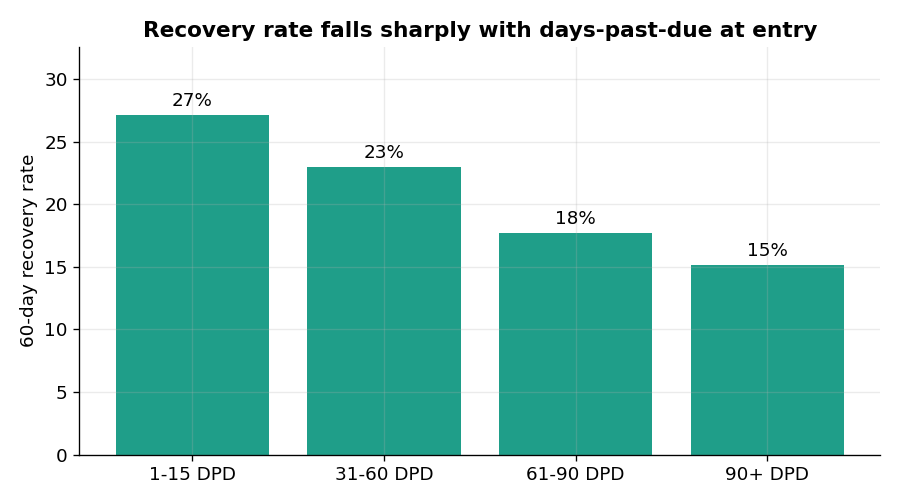
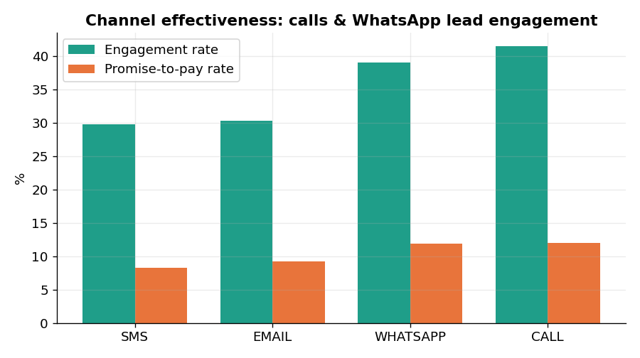
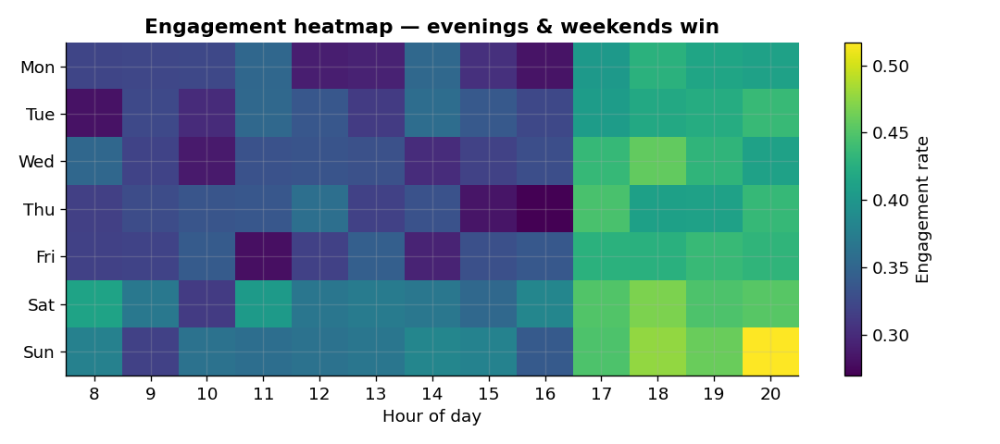
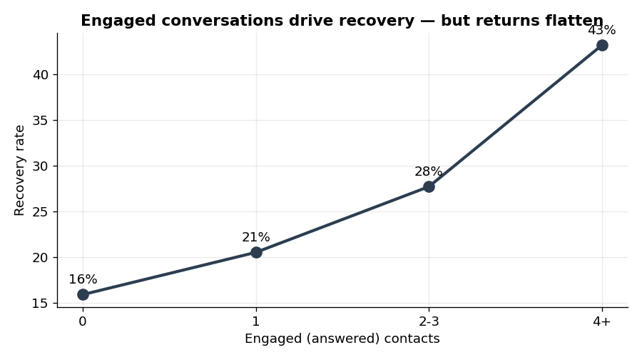
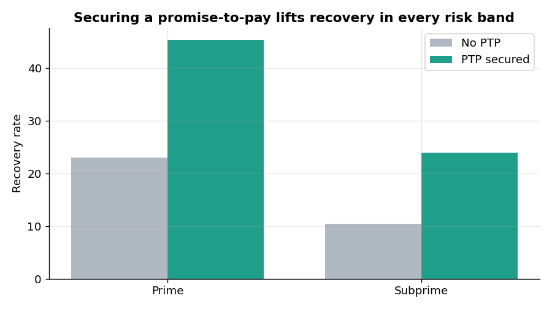
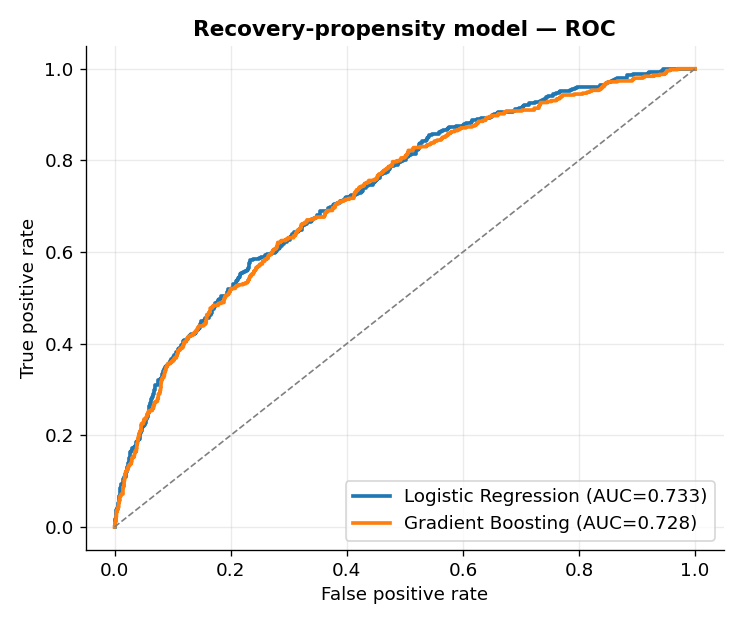
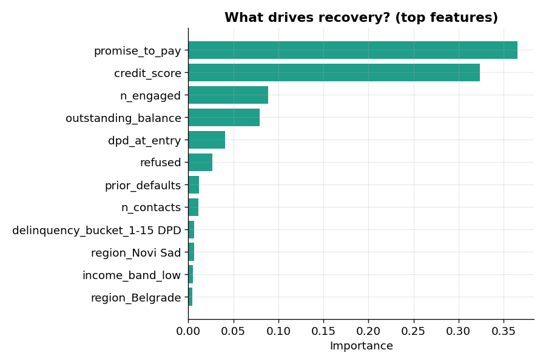
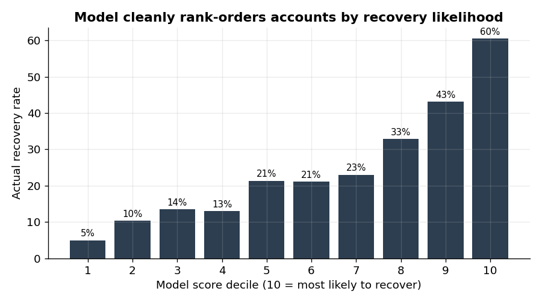
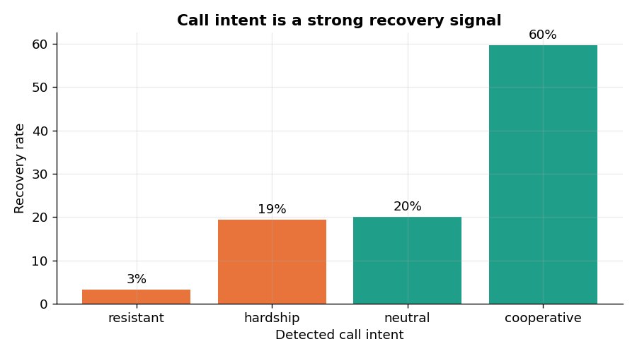
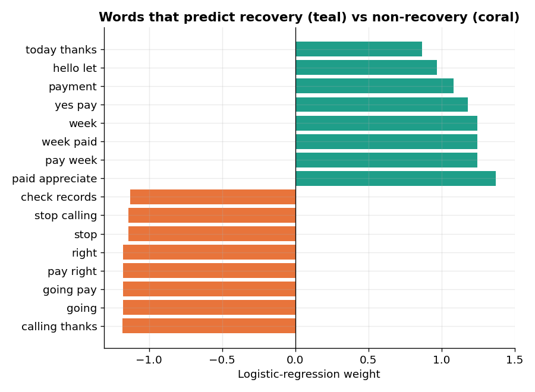

# Collections R&D Analytics — Recovery Optimisation

**An end-to-end research & data-exploration project for a fintech collections team.**
It takes a delinquent-loan portfolio and answers the core R&D question:
*where do we lose recoverable money, and which behavioural levers move recovery rates?*

The project covers the full analyst workflow named in the role: **SQL** on a
collections schema, **Python EDA**, hypothesis development and validation,
**behavioural-signal discovery**, a **recovery-propensity model**, **NLP on call
transcripts**, and a **stakeholder dashboard**.

> ⚠️ **Data is 100% synthetic** — generated by `src/01_generate_data.py`. No real
> customer data is used. Variable relationships are simulated to mirror real
> lending/collections dynamics so the findings are realistic and defensible.

---

## TL;DR — what the analysis found

| Finding | Evidence | So what |
|---|---|---|
| Recovery collapses as accounts age | 27% at 1–15 DPD → 15% at 90+ DPD | Work accounts **earlier**; late entry is where money is lost |
| Talking to people is *the* lever | 0 engaged contacts → 16% recovery; 4+ → 43% | Optimise for **conversations**, not raw dial volume |
| Calls & WhatsApp win engagement | 41% / 39% vs ~30% for SMS/email | Shift channel mix for high-value accounts |
| A promise-to-pay ~doubles recovery | Prime: 23% → 45%; Subprime: 10% → 24% | Coach agents to **secure a PTP** every call |
| Evenings & weekends engage best | Contact-timing heatmap | Re-weight the **dialer schedule** |
| Call language predicts repayment | Text-only model **ROC-AUC 0.80**; "cooperative" calls recover 60% vs 3% for "resistant" | Mine **transcripts** for real-time risk signals |
| The model rank-orders cleanly | Top decile **60%** recovery vs bottom **5%** → **12× lift** | Prioritise agent effort by **propensity score** |

---

## Dashboard

An interactive, self-contained dashboard (`outputs/dashboard.html`) — open it in any browser.



---

## Key visuals

**1. Recovery rate by delinquency bucket** — earlier intervention recovers more.


**2. Channel effectiveness** — calls & WhatsApp lead on engagement and promise-to-pay.


**3. Best time to contact** — engagement heatmap by weekday × hour.


**4. Engaged conversations vs recovery** — the strongest operational lever.


**5. Promise-to-pay lift** — holds in every risk band.


**6. Recovery-propensity model — ROC.**


**7. What drives recovery — feature importance.**


**8. Score deciles** — model cleanly rank-orders accounts by recovery likelihood.


**9. Call intent vs recovery (NLP).**


**10. Words that predict recovery vs non-recovery.**


---

## How it's built

```
collections-rnd-analytics/
├── README.md                  ← you are here
├── requirements.txt
├── run_all.sh                 ← reproduce everything in one command
├── data/                      ← generated synthetic CSVs (+ kpis.json)
├── sql/
│   └── collections_analysis.sql   ← 7 R&D queries (recovery, channel, timing, PTP lift…)
├── src/
│   ├── 01_generate_data.py    ← synthetic portfolio generator
│   ├── 02_eda_signals.py      ← EDA + behavioural-signal charts
│   ├── 03_model.py            ← recovery-propensity model (LogReg vs Gradient Boosting)
│   └── 04_text_analytics.py   ← NLP on call transcripts (TF-IDF + intent tagging)
├── outputs/
│   ├── charts/                ← 10 PNG charts
│   ├── dashboard.html         ← interactive dashboard
│   ├── model_scores.csv       ← per-account recovery probability + decile
│   └── *_metrics.json
└── reports/
    └── insights_report.md     ← stakeholder-style write-up
```

### The data model
A simulated portfolio of **8,000 delinquent accounts**: `customers`, `accounts`,
`contacts` (35k outreach attempts), `payments`, and `transcripts` (6.6k calls).

### Methods
- **SQL** — cohorting, recovery rates by bucket, channel & timing analysis,
  stratified promise-to-pay lift, high-value watchlist (BigQuery/Snowflake-style).
- **EDA / signals** — pandas + matplotlib.
- **Modelling** — scikit-learn `Pipeline` (scaling + one-hot), Logistic Regression
  vs Gradient Boosting, evaluated on ROC-AUC / PR-AUC, with decile lift.
- **NLP** — rule-based intent lexicon + TF-IDF Logistic Regression on transcript
  text, surfacing the most predictive words.

---

## Run it yourself

```bash
# 1. clone, then from the project root:
python -m venv .venv && source .venv/bin/activate    # Windows: .venv\Scripts\activate
pip install -r requirements.txt

# 2. reproduce the full pipeline
bash run_all.sh
#   …or run the steps individually:
cd src
python 01_generate_data.py
python 02_eda_signals.py
python 03_model.py
python 04_text_analytics.py
```

All charts land in `outputs/charts/`; open `outputs/dashboard.html` in a browser.

---

## How this maps to the R&D Analyst (Collections) role

| Role requirement | Where it shows up here |
|---|---|
| Analytical research to improve collection performance | The whole project: hypotheses → validation → recommendations |
| Explore customer/payment/operational data for patterns | `02_eda_signals.py`, `sql/` |
| Develop & validate hypotheses | PTP-lift, early-intervention, contact-intensity hypotheses (stratified tests) |
| Identify new behavioural signals | Contact timing, channel, PTP, **call-language signals** |
| Build dashboards & analytical tools | `outputs/dashboard.html`, 10 charts, `model_scores.csv` |
| Strong SQL on large datasets | `sql/collections_analysis.sql` |
| Python analytical tooling | pandas, scikit-learn |
| ML / predictive modelling *(bonus)* | recovery-propensity model |
| Speech-to-text / unstructured data *(bonus)* | `04_text_analytics.py` on call transcripts |
| Communicate insights to stakeholders | TL;DR table, `reports/insights_report.md` |

---

## Author
**Ogabek** · built as a portfolio project demonstrating collections R&D analytics.
Stack: Python (pandas, scikit-learn, matplotlib), SQL, Chart.js.
